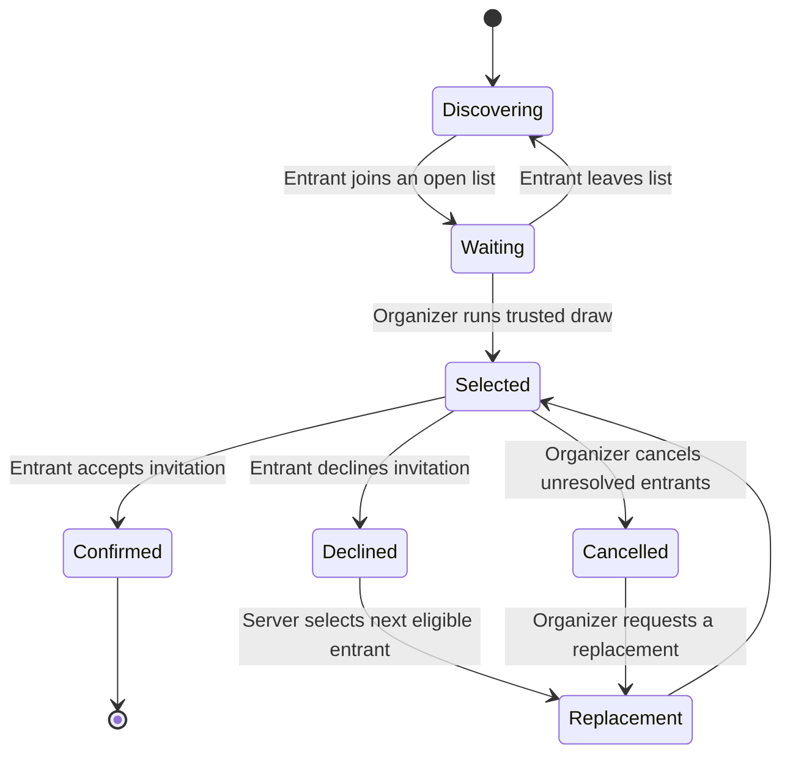
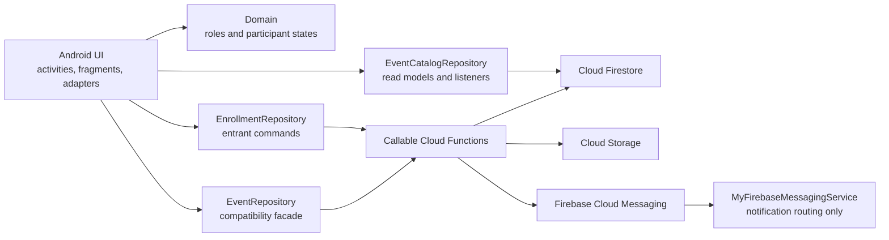

# Ticketjack

[](https://aaryan-mk7.github.io/Ticketjack/)

**[Open the public project preview →](https://aaryan-mk7.github.io/Ticketjack/)**

Ticketjack is an Android application for fair, lottery-based event registration. Instead of rewarding the fastest person to refresh a screen, entrants join an open waiting list; organizers run a transparent draw; selected entrants accept or decline; and the system can draw replacements when needed.

The app supports three roles:

- **Entrants** discover events, scan event QR codes, join waiting lists, receive and respond to invitations, review history, and control notification preferences.
- **Organizers** create and manage events, inspect participant groups, view required entrant locations, run draws, draw replacements, export lists, and communicate with entrants.
- **Administrators** moderate profiles, events, organizers, uploaded posters, and notification audit records.

Ticketjack uses a Java/XML Android client with Firebase Authentication, Firestore, Storage, Cloud Messaging, and Node.js callable Cloud Functions.

## Product model
### Fair registration lifecycle


The draw, response, replacement, cancellation, notification fan-out, event deletion, and administrative moderation routes are server-authoritative. A user interface is not an authorization boundary, so state changes do not depend on a client-side role check.

### User journeys
**Entrant**

1. Select the Entrant role and register under anonymous Firebase Authentication.
2. Browse currently open events by category, date, or search term, or scan a QR code.
3. Open details and join the waiting list. If required, Ticketjack shares the device’s last known location only for that entry.
4. Receive a selection notification and accept or decline from Invitations.
5. Review history and adjust profile/notification preferences.

**Organizer**

1. Register with email/password, create a complete event, and upload a poster.
2. Set the required event capacity and registration interval, plus an optional waiting-list limit, category, guidelines, location, and geolocation requirement.
3. Open an event to view entrants, run a bounded random sample that cannot exceed capacity, notify selected entrants, and manage cancellations/replacements.

**Administrator**

1. Sign in with a role provisioned by a trusted administrator.
2. Review platform data and open a moderation tool.
3. Deactivate an organizer and their events, remove a profile, remove a poster, or inspect notification records.

## Architecture
### System overview


### Android boundaries
The app deliberately remains a single Java/XML Android module. A Kotlin/Compose or multi-module rewrite would create unnecessary migration risk while Firebase-facing workflows are being hardened.

```text
app/src/main/java/com/example/fairchance/
├── data/repository/
│   ├── EventCatalogRepository.java   # event + status reads
│   ├── EnrollmentRepository.java     # entrant callable commands
│   ├── AuthRepository.java           # auth/profile and admin commands
│   ├── AdminImageRepository.java     # trusted poster moderation
│   └── EventRepository.java          # compatibility facade during migration
├── domain/
│   ├── UserRole.java                 # validated navigation roles
│   ├── ParticipationStatus.java      # canonical history states
│   └── workflow validators/helpers
├── models/                            # Firestore-compatible POJOs
├── service/                           # FCM token + notification presentation
└── ui/                                # activities, fragments, adapters
```

`EventRepository` remains a compatibility facade for older screens. New work must not extend it:

- Catalog/status/listener reads belong in a focused read repository.
- Entrant commands belong in `EnrollmentRepository`.
- Lottery, cancellation, notification, deletion, and moderation belong in Cloud Functions.
- Feature UI should render loading/content/empty/error states rather than coordinating raw Firestore writes.

### Navigation
`MainActivity` owns the single `dashboard_container` host and selects an entrant, organizer, or administrator experience from `UserRole`. The obsolete duplicate fragment container was removed. Entrant and organizer bottom navigation are initialized per validated role; administrator routes omit the bottom bar.

Notification taps route through `MainActivity`. `MyFirebaseMessagingService` presents notifications and opens Invitations for selection messages; it never mutates event history locally because the Cloud Function owns that transition.

## Visual system
Ticketjack’s Material 3 design system is defined in:

- `app/src/main/res/values/colors.xml`
- `app/src/main/res/values/themes.xml`
- `app/src/main/res/values/styles.xml`
- `app/src/main/res/values/dimens.xml`

It supplies semantic primary, secondary, error, surface, outline, and on-surface colors; consistent button/card/input shapes; spacing; and a shared type scale. Core screens follow the same hierarchy:

- a task-oriented heading;
- one prominent primary action;
- outlined secondary/destructive alternatives;
- status labels that do not rely on color alone;
- 48dp minimum control height;
- loading, empty, and error states;
- resource-backed colors/styles rather than screen-local design constants.

Account selection, authentication, entrant discovery, event details, event cards, invitations, organizer dashboard, event creation, event lists, and waiting-list controls use this foundation. Remaining legacy layouts inherit the Material 3 theme and should use the same Ticketjack resources when edited.

## Firebase data model
```text
users/{uid}
├── email, name, phone
├── role: entrant | organizer | admin
├── fcmToken
├── notificationPreferences
│   ├── lotteryResults
│   └── organizerUpdates
├── isActive, roleActive, deactivation metadata
└── eventHistory/{eventId}
    ├── eventName, eventDate
    ├── status: Waiting | Selected | Confirmed | Declined | Cancelled
    └── updatedAt

events/{eventId}
├── organizerId, createdById, createdAt
├── name, description, category, guidelines, location
├── registrationStart, registrationEnd, eventDate
├── capacity, waitingListLimit, geolocationRequired
├── posterImageUrl and poster metadata
├── isActive and deactivation metadata
├── waitingList/{uid}
│   ├── joinedAt
│   └── location (optional GeoPoint)
├── selected/{uid}
│   ├── status: pending | notified | accepted | declined | cancelled
│   └── sampledAt, notifiedAt, response/replacement metadata
├── confirmedAttendees/{uid}
├── cancelled/{uid}
└── notificationLogs/{logId}

notificationLogs/{logId}                 # canonical platform audit stream
adminRemovalLogs/{logId}
eventRemovalLogs/{logId}
imageRemovalLogs/{logId}
organizerDeactivationLogs/{logId}
```

Every server-triggered notification records both event-scoped context and a top-level audit record. Results distinguish `recipientCount`, actual `sentCount`, `failureCount`, and `skippedCount`; an absent FCM token is not reported as a delivery.

## Security model
### Direct client access
`firestore.rules` and `storage.rules` are versioned with the repository and deployed with Firebase:

- Signed-in users can read events.
- Users can create only their own `entrant` or `organizer` profile. A client cannot create an administrator account.
- A user can alter only a limited set of their own profile fields and cannot alter their role.
- Organizers create/update only events they own; `organizerId` and `createdById` are immutable from the client.
- Participant subcollections and event history are read-only to clients. Callable functions own their state transitions.
- The Storage poster path is restricted to an active event owner or administrator and accepts images smaller than 10 MiB.
- Audit logs are read-only and administrator-visible.

### Callable functions
`functions/index.js` exports:

- `joinWaitingList({ eventId, latitude?, longitude? })`
- `leaveWaitingList({ eventId })`
- `respondToInvitation({ eventId, accepted })`
- `sampleAttendees({ eventId, count })`
- `drawReplacement({ eventId, cancelledEntrantId })`
- `cancelPendingEntrants({ eventId })`
- `sendChosenNotifications({ eventId, entrantId? })`
- `sendWaitingListNotifications({ eventId, message? })`
- `sendCancelledNotifications({ eventId, message? })`
- `deleteEvent({ eventId })`
- `deactivateOrganizer({ organizerId, reason? })`
- `deleteUserProfile({ userId })`
- `deleteOwnAccount()`
- `removeEventPoster({ eventId, imageUrl })`

Each function validates Firebase Authentication, reads the caller’s active role, and verifies administrator access or organizer ownership where required. Enrollment and lottery operations use Firestore transactions so capacity checks, state transitions, and associated history writes remain coherent under concurrent requests. Cancellation and notification finalization update only live invitations, replacement draws can run only once per cancelled entry, and entrant responses win concurrent races.

Account deletion is also server-authoritative. It recursively removes the profile and history, clears participant references from events, removes the Firebase Authentication record, and deactivates events owned by a self-deleting organizer.

### Administrator bootstrap
The Android client intentionally cannot self-register an administrator. Bootstrap a first administrator through trusted server tooling, the Firebase Admin SDK, or a secure operational script by creating a Firebase Auth account and a matching Firestore profile with `role: "admin"`. Do not add a public administrator registration route.

## Local setup
### Prerequisites
- Android Studio and Android SDK 36
- JDK 17
- Node.js 22
- Firebase CLI
- A Firebase project with Authentication, Firestore, Storage, Cloud Messaging, and Functions enabled
- A Google Maps SDK for Android key if entrant-location maps are used

### Android configuration
```bash
git clone https://github.com/Aaryan-MK7/Ticketjack.git
cd Ticketjack
cp local.properties.example local.properties
```

Set the Android SDK and Maps key in `local.properties`:

```properties
sdk.dir=/absolute/path/to/Android/sdk
MAPS_API_KEY=your_restricted_google_maps_api_key
```

Keep the Maps key restricted to package `com.example.fairchance`, approved signing-certificate SHA-1 fingerprints, and the Maps SDK for Android.

The checked-in `app/google-services.json` and `.firebaserc` identify the original Firebase project. For a separate project:

1. Create an Android Firebase app using `com.example.fairchance`.
2. Replace `app/google-services.json` and update `.firebaserc`.
3. Enable anonymous and email/password providers.
4. Create Firestore and Storage.
5. Provision the first administrator through trusted tooling.
6. Deploy rules, indexes, and functions before exercising protected mutations.

### Install, emulate, and deploy
```bash
npm ci --prefix functions
npm test --prefix functions

# Deploy rules, indexes, Storage policy, and Functions.
firebase deploy

# Use disposable data for local integration work.
firebase emulators:start --only auth,firestore,storage,functions
```

Do not run destructive moderation or integration tests against production data.

## Development and verification
### Android
```bash
./gradlew testDebugUnitTest
./gradlew lintDebug
./gradlew assembleDebug
./gradlew connectedDebugAndroidTest
```

### Cloud Functions
```bash
npm ci --prefix functions
npm test --prefix functions
npm audit --prefix functions --omit=dev
```

### Release checklist
1. Run Android unit tests, lint, and a debug build with JDK 17.
2. Run Functions tests and exercise protected functions through emulators.
3. Deploy rules, indexes, Storage rules, and Functions together.
4. Verify behavior as entrant, organizer, administrator, and an unauthorized signed-in user.
5. Exercise concurrent waitlist joins and invitation responses in a dedicated test project.
6. Run instrumentation tests on at least one supported emulator or device.

## Firestore indexes
`firestore.indexes.json` includes the composite history index used for pending invitations:

```text
eventHistory: status ASC, eventDate DESC
```

When Firebase surfaces a new required index link for a future query, add its definition to `firestore.indexes.json` rather than relying on console-only configuration.

## Operational notes
- Entrant accounts are anonymous. Clearing app data or changing devices can make an account inaccessible; add account linking before treating this as a production account system.
- Caller authorization is based on Firestore role documents and event ownership. Rules protect direct client access; callable functions protect high-risk workflows.
- Event capacity is required, limited to 1–10,000, immutable after creation, and enforced by the server during each draw.
- The app retains the `com.example.fairchance` package/application identifier to stay compatible with the Firebase client configuration. The product name is Ticketjack.
- QR content is an event identifier. Visibility and authorization still come from Firestore/Functions, not the QR code.
- Event poster removal is administratively audited. Event deletion is recursive and server-only because a Firestore document delete does not otherwise remove nested subcollections.

## Troubleshooting
### Android build cannot find Java
Install JDK 17 and set `JAVA_HOME`:

```bash
export JAVA_HOME=$(/usr/libexec/java_home -v 17)
```

### Functions report permission denied
Confirm that the Firebase user has a matching `users/{uid}` profile, an active account, and the required role. For organizer actions, confirm `events/{eventId}.organizerId` or `createdById` equals that user’s UID.

### An organizer cannot update an older event
Backfill legacy event documents with both `organizerId` and `createdById`. The rules intentionally reject client-side ownership changes.

### A waitlist action does not update
Confirm that the Functions deployment matches the Android Firebase project and that the device has a valid entrant profile. Capacity and status checks run on the server, so a closed/full/duplicate entry correctly returns an error.

### Maps are blank
Verify `MAPS_API_KEY`, Maps SDK enablement, billing requirements, Android package/SHA-1 restrictions, and network connectivity.

## Attribution
Ticketjack was migrated from the CMPUT 301 Fall 2025 Binary 1 project. Original contributors are retained in `docs/team.txt`. No license is currently supplied; add one before distributing the application or accepting third-party contributions.